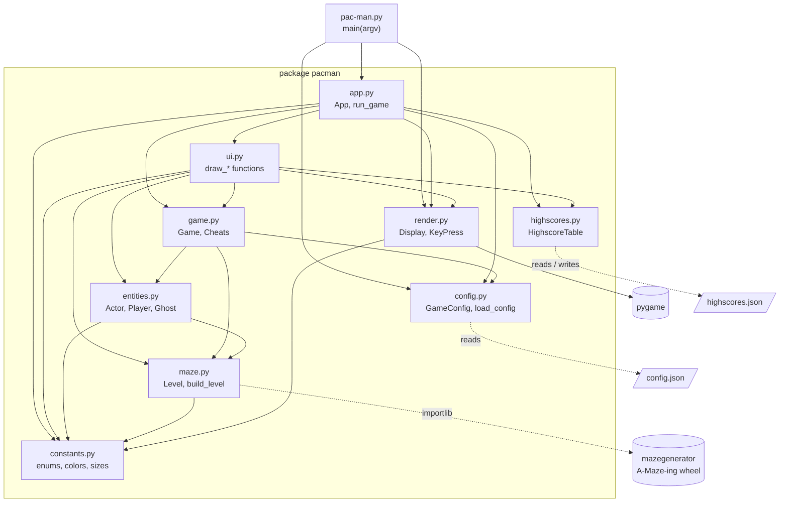

# Module dependencies

*Package diagram*

The entry script only knows `app`, `config` and `render`. Pygame is touched in one place, `render.py`, and the A-Maze-ing wheel is imported lazily by `maze.py`. `constants.py` sits at the bottom and depends on nothing.

[Back to the index](README.md)
