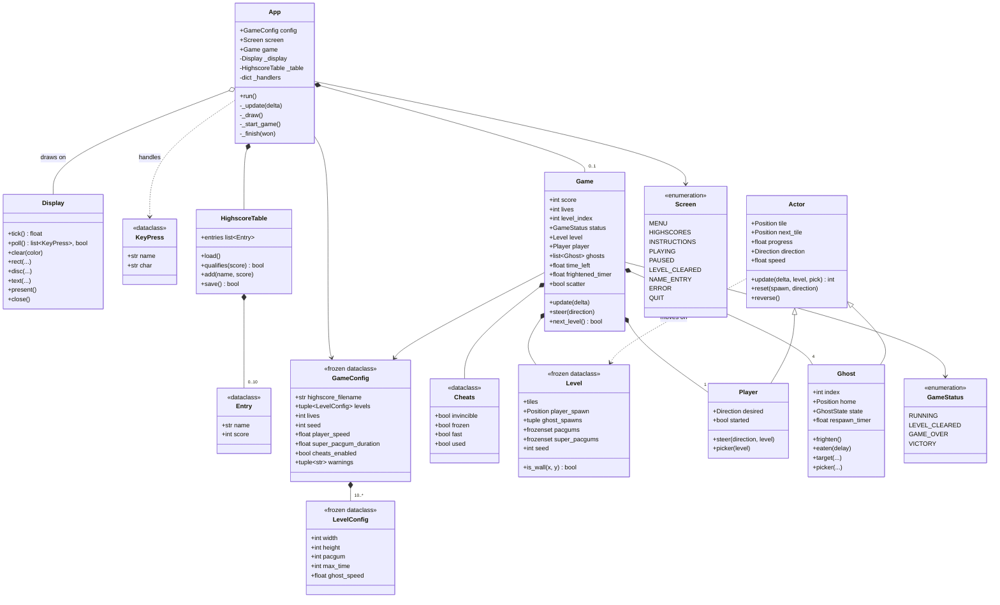

# Core types

*Class diagram*

`App` owns the window, the highscore table and at most one `Game`. A `Game` owns the current `Level`, one `Player` and four `Ghost`s. Configuration and levels are frozen dataclasses that flow down, never up.

- `Position` is an alias for `tuple[int, int]`, a tile coordinate.
- `Direction`, `Tile` and `GhostState` are enums in `constants.py`.
- Ghost indices 0–3 map to Blinky, Pinky, Inky and Clyde, each with its own `target()` rule.

[Back to the index](README.md)
