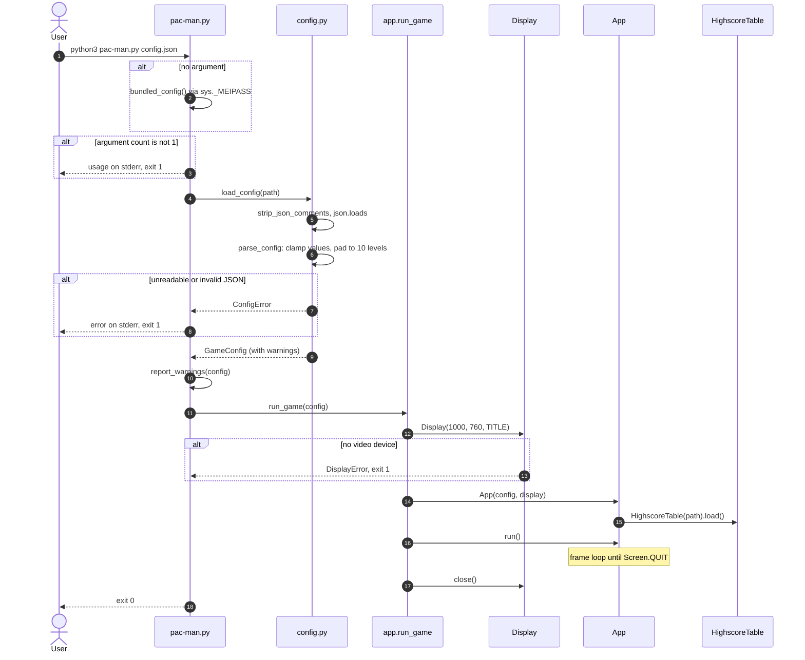

# Startup

*Sequence diagram*

From `python3 pac-man.py config.json` to the first frame. A frozen build with no argument falls back to the `config.json` bundled by PyInstaller.

[Back to the index](README.md)
