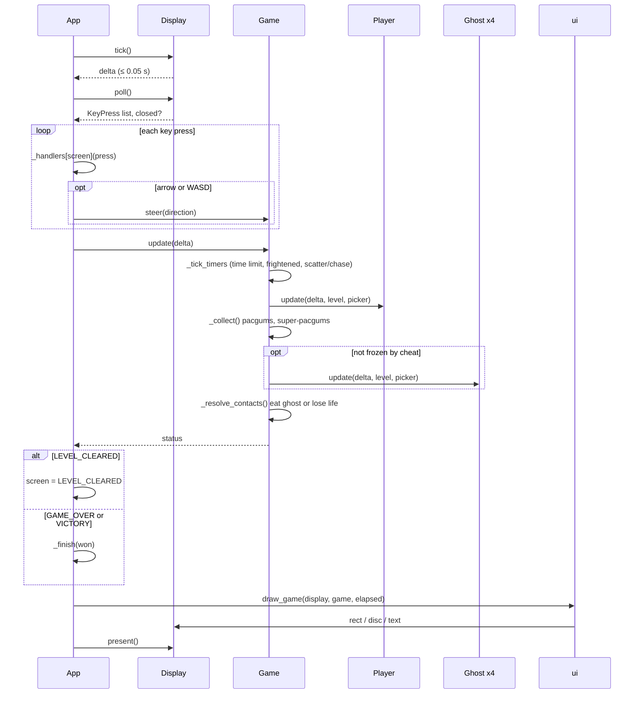

# One frame while playing

*Sequence diagram*

`App.run()` repeats this at 60 FPS. Delta time is clamped to 50 ms so a stalled window never teleports Pac-Man through walls.

[Back to the index](README.md)
