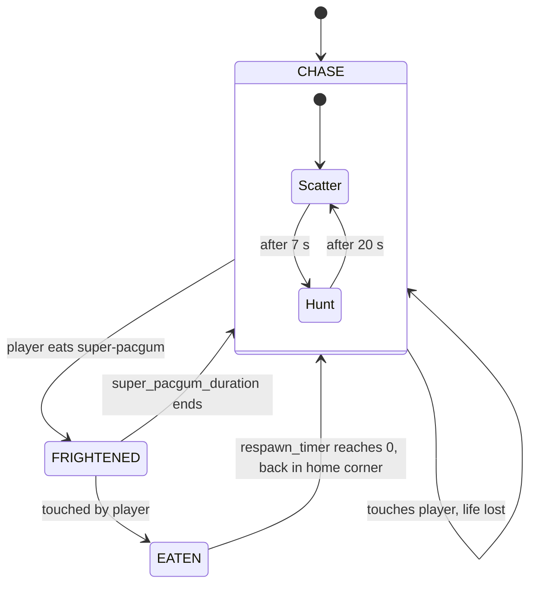

# Ghost lifecycle

*State diagram*

Each ghost carries a `GhostState`. While chasing, the whole pack alternates between a 7 s scatter phase (head for the home corner) and a 20 s chase phase.

[Back to the index](README.md)
