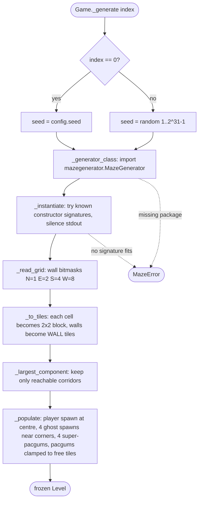

# Building a level

*Activity diagram*

`maze.build_level()` turns a generator maze of *w × h* cells into a playable grid of *(2w+1) × (2h+1)* tiles. Level 1 uses the configured seed; later levels draw a random one.

[Back to the index](README.md)
