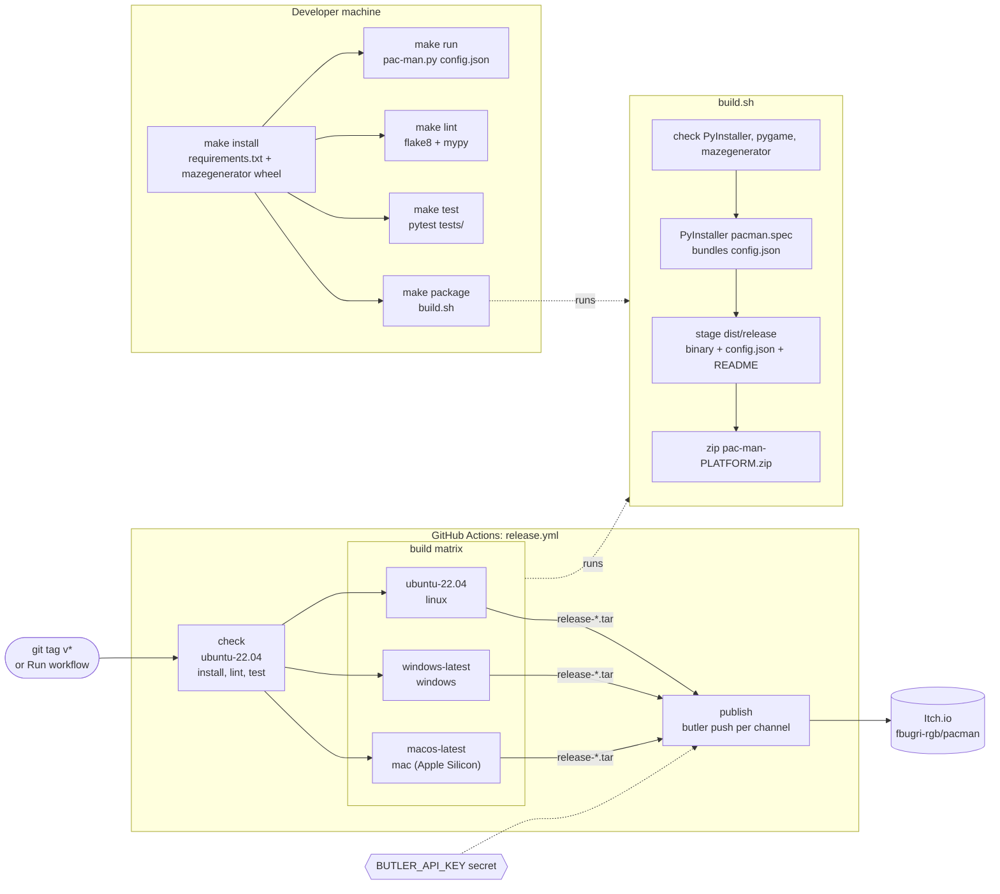

# Build and release

*Deployment diagram*

Local work goes through the `Makefile`. A pushed `v*` tag or a manual run of `release.yml` lints, tests, freezes on three runners and pushes to Itch.io with butler.

[Back to the index](README.md)
